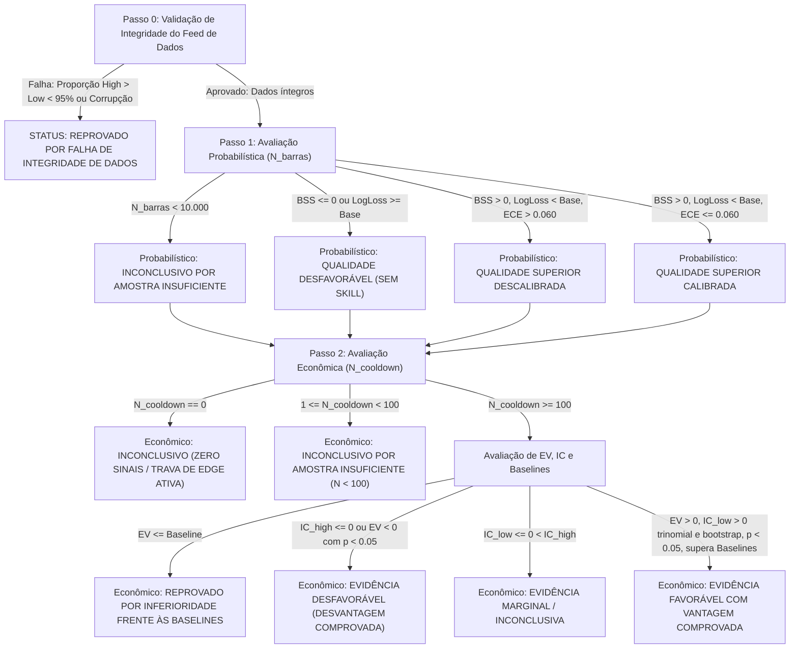

# Protocolo Técnico Pré-Registrado — Etapa 7: Validação Prospectiva Fora da Amostra
## Versão Candidata à Aprovação (Pré-Registro Condicionado à Custódia Criptográfica)

**Documento:** `docs/protocolo_etapa7_validacao_prospectiva.md`  
**Ativo-Alvo:** EUR/USD (Cotações BID exclusivamente)  
**Frequência:** M1 (Candles OHLCV de 1 minuto fechados)  
**Horizonte de Liquidação:** 5 minutos ($h = 5\,\text{min}$)  
**Payout Contratual de Referência:** $r = 0.80$ ($80\%$)  
**Status do Documento:** **VERSÃO CANDIDATA À APROVAÇÃO**  
*(Aviso de Governança: Este documento formaliza as decisões metodológicas propostas para a validação prospectiva. Não adquire validade operacional de pré-registro ativo até que o usuário aprove formalmente suas pendências, o modelo seja treinado/serializado com hash fixado e a custódia pública seja registrada antes do início da coleta).*  
**Data/Hora UTC de Elaboração:** 24 de outubro de 2026, 23:59:00 UTC  
**Modo Operacional Ativo:** `RESEARCH_MODE_NO_PROVEN_EDGE`  

---

## 1. Identificação Criptográfica do Código, Configuração e Dependências Congeladas

Para garantir a impossibilidade de adulteração retrospectiva de código, substituição de parâmetros ou ajuste seletivo de testes após a observação dos dados futuros, a validação prospectiva vincula-se estritamente aos seguintes hashes criptográficos SHA-256:

### 1.1. Arquivos-Fonte do Sistema Quantitativo

| Arquivo | Hash SHA-256 (Estado Congelado) | Responsabilidade Metodológica no Pipeline |
| :--- | :--- | :--- |
| `app.py` | `7f04af320f4dcfca867319da09997d8455d22e3b6da7f6454ebfb3cd340dae27` | Interface de monitoramento, auditoria visual e governança |
| `backtest.py` | `5c0a683867f5651bca7313429e494362e7bfbc9cd73476dd4ffbabdf7995ba3e` | Motor cronológico de simulação, cooldown e baselines não arredondadas |
| `data_loader.py` | `2913b4e0910604e14a54457283f5b056ccd2c228d6fedbc954e1a27cd5de9696` | Validação de consistência OHLCV, fusos UTC e invalidação de lacunas |
| `features.py` | `45a51de7d27a511e5e1db248708838811604625dca7b27791ef36b5843fcc220` | Construção de 25 features causais e alvo contratual de 5 minutos |
| `indicators.py` | `74224bdee0fa07dd38c836237f9ee71fbe1d87091ef0febcc588ea65d80beb16` | Cálculo matemático causal de indicadores (RSI, ATR, EMAs, volatilidade) |
| `model.py` | `7ac71d211cc544bd2dc9724243cab4b4595837c8d6c76c07bbf72a4da26d9e61` | Modelos preditivos, calibração ECE e seleção estrita por Brier Skill Score |
| `risk.py` | `314e15901872ec72f3734b9cef5972aee194a8fec63e73ac03e416c89202d0ba` | Avaliação de payoff, IC trinomial analítico, moving block bootstrap |
| `signals.py` | `c6e0baff2698100a9664bb07f650a6a930457680b16f7f4a4db90c70d3a973cc` | Classificação de sinais CALL/PUT/NO_TRADE e trava de segurança de edge |
| `validation.py` | `5683caad68ac159a4b9bb0920c56abc0cb4c2274e8ce151966cbb71c4401c141` | Purga temporal, embargo inter-fold e governança formal de holdout |
| `tests/test_quant_system.py` | `ce0d6035396bedf57b13eabb07e2ce94c63d0a1b2fe78617a3a270c9beb978ac` | Suíte automatizada com 40 testes de regressão (100% de aprovação) |

### 1.2. Ambiente de Execução e Dependências de Software

- **Interpretador Python:** `3.14.4 (MSC v.1944 64-bit AMD64)`
- **`scikit-learn`:** `1.9.1`
- **`numpy`:** `2.5.4`
- **`pandas`:** `3.1.0`
- **`scipy`:** `1.18.1`
- **`pytest`:** `9.1.1`

### 1.3. Dados Históricos Pré-Observados (Base Retrospectiva)

O protocolo reconhece e preserva a identidade dos 7 arquivos históricos inspecionados nas Etapas 1 a 6 (`HISTORICAL_REGRESSION_ALREADY_OBSERVED`). Sob nenhuma hipótese esses dados poderão ser denominados ou tratados como teste prospectivo virgem:

| Arquivo Histórico | Período UTC | Hash SHA-256 |
| :--- | :--- | :--- |
| `data/eurusd_m1_2026_01_bid.csv` | 2026-01-01 a 2026-01-31 | `6b4f104140657bc5601b8d69ec259502ca3b717f14cd1a47017ede07ca4e4d06` |
| `data/eurusd_m1_2026_02_bid.csv` | 2026-02-01 a 2026-02-28 | `5bead60e7901f04eb09e575f9dd9a4802c7772dabc0d0857088a5f31f9f6ac2d` |
| `data/eurusd_m1_2026_03_bid.csv` | 2026-03-01 a 2026-03-31 | `2408bbcb272f25fe14c811dab3d83205f1674a4b84a80d8e129044c31c1d90b5` |
| `data/eurusd_m1_2026_04_bid.csv` | 2026-04-01 a 2026-04-30 | `e4e9d80b308e025d5c4279b87eb1a0ae72963bb42cc16b35523e2995e5020803` |
| `data/eurusd_m1_2026_05_bid.csv` | 2026-05-01 a 2026-05-31 | `51ed993350161ea70fcd88d87e5ec22f1b0144a39ca56b45a16f5c6e76369bc4` |
| `data/eurusd_m1_2026_06_bid.csv` | 2026-06-01 a 2026-06-30 | `6705cae8f65bc00112d9da50bf1bd4e1cac94bec7a2284551b1786b8ddab8646` |
| `data/eurusd_m1_2026_07_bid.csv` | 2026-07-01 a 2026-07-31 | `3482474a8ef3fabcad41ac799a775e1e4a51c32f687a88f0c49b429447eb4bb7` |
| `scratch/stage3_results.json` | Resultados Retrospectivos Etapa 3 | `65cd269aeb1d6cef3a2894417a54b286d290a4bfb88da80d5b3af2161de3b31f` |

---

## 2. Janela Temporal da Validação e Regras contra Interrupção Seletiva (*Selective Stopping*)

### 2.1. Definição Temporal Estrita da Coleta

A janela temporal proposta para a validação prospectiva é estritamente fixada:
- **Timestamp de Início ($T_{\text{start}}$):** `2026-11-01 00:00:00 UTC`
  - *Condição de Validade:* O início da coleta é obrigatoriamente condicionado à comprovação de publicação de custódia pública imutável contendo o hash deste protocolo e do modelo serializado com timestamp RFC 3161 ou commit Git público **anterior a `2026-11-01 00:00:00 UTC`**.
  - Se a custódia for publicada após `2026-11-01 00:00:00 UTC`, a data de início será deslocada formalmente para o primeiro candle imediatamente posterior ao registro de custódia, sendo proibida a retroação.
- **Timestamp de Encerramento Fixo ($T_{\text{end}}$):** `2026-12-31 23:59:59 UTC`
  - *Regra Estrita de Não-Prorrogação:* A janela encerra-se compulsoriamente no timestamp fixado. É expressamente vedado estender o período de coleta para "aguardar mais operações", "recuperar sequências perdedoras" ou tentar atingir metas amostrais de $N_{\text{cooldown}}$.
- **Duração Nominal:** 2 meses civis completos (novembro e dezembro de 2026), com expectativa estimada entre 60.000 e 62.000 candles M1 válidos de negociação.

### 2.2. Estatuto Epistemológico dos Dados: "Dados Futuros a Coletar"

- É estritamente vedado denominar os dados de novembro a dezembro de 2026 como "dados prospectivos certificados" ou "holdout virgem" antes da comprovação pública de que este protocolo e o modelo estavam congelados antes do primeiro candle do período.
- Até a homologação da custódia, os dados do período são designados unicamente como **"dados futuros a coletar"** ou **"candidato a período fora da amostra"**.

### 2.3. Proibição de Parada Antecipada (*Early Stopping on Local Peaks*)

- A coleta e o registro causal de previsões prosseguirão ininterruptamente do primeiro ao último segundo do período fixado.
- É estritamente proibido interromper a avaliação prospectiva em momentos de rentabilidade acumulada favorável (*peak cherry-picking*), assim como é proibido desconsiderar subperíodos desfavoráveis.

---

## 3. Base de Treinamento, Congelamento do Modelo e Trava de Segurança

### 3.1. Base de Treinamento Proposta (Jan–Jun/2026, 6 Meses)

- **Composição Proposta:** Meses de janeiro a junho de 2026 (`eurusd_m1_2026_01_bid.csv` a `06_bid.csv`), totalizando 254.996 barras M1 brutas.
- **Justificativa da Exclusão de Julho/2026 do Treinamento:** O mês de julho de 2026 foi amplamente inspecionado nas Etapas 1, 4 e 6 para auditoria de divergências e testes de hipótese. Para prevenir contaminação dos pesos do regressor e evitar viés de seleção retrospectiva, Julho deve ser mantido fora do conjunto de ajuste.
- **Condição de Validade:** Esta proposta depende de confirmação explícita do usuário antes da materialização do artefato serializado.

### 3.2. Congelamento Criptográfico do Modelo e Pré-Processamento

Antes do início da coleta em `2026-11-01 00:00:00 UTC`:
1. O pipeline preditivo (`StandardScaler` + `LogisticRegression(C=0.05, penalty='l2')`) será ajustado na base de treino autorizada e serializado em arquivo imutável (ex.: `artifacts/model_frozen_stage7.joblib`).
2. O hash SHA-256 do arquivo serializado será calculado e inserido no manifesto de custódia pública.
3. Durante toda a validação prospectiva, os pesos $\mathbf{w}$, o intercepto $b$, as médias $\boldsymbol{\mu}$ e os desvios $\boldsymbol{\sigma}$ do scaler são estritamente **somente-leitura**. Proibido qualquer retreinamento em tempo real (*online learning*), ajuste de pesos ou reponderação bayesiana.

### 3.3. Trava de Segurança Operacional (`RESEARCH_MODE_NO_PROVEN_EDGE`)

- O sistema opera sob o modo inegociável `RESEARCH_MODE_NO_PROVEN_EDGE`.
- A regra de emissão de sinais em `signals.py` exige cumulativamente:
  $$p_{\text{eff}} \ge p_{\text{req}} = \frac{1 + \text{min\_ev}}{1 + r} + \text{ECE\_penalty}$$
  $$\text{has\_validated\_oos\_edge} == \text{True}$$
- Caso a base retrospectiva não forneça validação formal de edge OOS, a trava de segurança forçará o estado `STATE_NO_TRADE` para todas as barras.
- **Proibição Estrita de Relaxamento de Limiares:** É proibido reduzir limiares, anular penalties de ECE ou contornar `has_validated_oos_edge` para fabricar operações artificiais no teste prospectivo.

---

## 4. Fonte de Dados, Validação e Tratamento de Anomalias

### 4.1. Especificação Cadastral do Feed Futuro
- **Par:** EUR/USD
- **Tipo de Cotação:** BID exclusivamente. Proibida a mistura de Ask ou preços médios Mid sem segregação explícita.
- **Frequência:** M1 (1 minuto fechado, período $t$ a $t+1\,\text{min}$).
- **Fuso Horário:** UTC estrito (`Etc/UTC` / `+00:00`), sem horários locais de verão.
- **Provedor:** Dukascopy Bank SA (Histórico de Tick/Barra exportado via Dukascopy Historical Data Feed).
- **Formato:** CSV padronizado (`timestamp`, `open`, `high`, `low`, `close`, `volume`).

### 4.2. Tratamento Causal de Anomalias e Degenerescência de Liquidez
Todo dado futuro passará obrigatoriamente pela validação de `data_loader.py`:
1. **Consistência de Preço:** Rejeição de barras com $Open, High, Low, Close \le 0$, ou $Low > High$, ou $Open, Close \notin [Low, High]$.
2. **Deduplicação:** Remoção estrita de timestamps repetidos mantendo a primeira ocorrência (`keep="first"`).
3. **Ordenação Cronológica:** Reordenação obrigatória por timestamp UTC crescente.
4. **Lacunas Intradiárias ($> 1\,\text{min}$ durante dias úteis de negociação):**
   - Proibição absoluta de interpolação sintética ou preenchimento (*no forward-fill*).
   - Invalidação estrita do alvo contratual de 5 minutos nas 5 barras anteriores à lacuna (`target_valid_5m = False`).
5. **Fechamento de Fim de Semana:**
   - Invalidação automática do alvo de 5 minutos nas 5 barras anteriores à interrupção de sexta-feira às 21:59 UTC até domingo às 21:00 UTC.
6. **Critério de Qualidade de Liquidez do Dataset:**
   - Se a proporção de candles com variação física ($High > Low$) for menor que $95\%$, o dataset é reprovado por qualidade insuficiente (`is_suitable_for_backtest = False`).

---

## 5. Arquitetura Preditiva e Registro Causal Append-Only

### 5.1. Conjunto Fechado de Features Preditivas (25 Variáveis Estritamente Causais)
Nenhuma variável preditiva poderá utilizar dados posteriores ao fechamento da barra de entrada no instante $t$:
$$\mathcal{F}_t = \{\text{ret\_1m}, \text{ret\_3m}, \text{ret\_5m}, \text{ret\_15m}, \text{rsi\_centered}, \text{atr\_pct\_14}, \text{momentum\_5m\_norm}, \dots, \text{rolling\_quality\_15m}\}$$
Todos os indicadores utilizam exclusivamente a série histórica acumulada até o fechamento de $t$. Proibidas janelas centralizadas ou vazamento temporal.

### 5.2. Alvo Contratual de Liquidação em 5 Minutos
Para cada candle no instante $t$:
- Timestamp de liquidação: $t_{\text{settle}} = t + 5\,\text{min}$.
- Preço de liquidação: $Close_{t+5\text{m}}$.
- Desfecho contratual:
  $$\text{Outcome}(t) = \begin{cases} \text{UP}, & \text{se } Close_{t+5\text{m}} > Close_t \\ \text{DOWN}, & \text{se } Close_{t+5\text{m}} < Close_t \\ \text{TIE}, & \text{se } Close_{t+5\text{m}} = Close_t \end{cases}$$

### 5.3. Encadeamento Causal de Logs Imutáveis (*Append-Only*)
Para garantir que as previsões antecedem a ocorrência dos resultados futuros:
1. **Previsão no Instante $t$:** Ao fechamento do candle $t$, o sistema extrai $\mathcal{F}_t$, calcula as probabilidades direcionais $P(\text{UP} \mid \mathcal{F}_t)$ e determina o estado do sinal (`CALL`, `PUT`, `SEM OPERAÇÃO`).
2. **Gravação Imediata em Log (`prospective_predictions.jsonl`):** Antes de processar qualquer informação de $Close_{t+1\text{m}}$ a $Close_{t+5\text{m}}$, o sistema grava a linha contendo:
   - `prediction_id`: identificador único UUIDv4
   - `timestamp_entry_utc`: timestamp $t$ em ISO 8601
   - `close_entry_price`: $Close_t$
   - `model_sha256`: hash SHA-256 do modelo congelado
   - `prob_up`: probabilidade float64
   - `prob_down`: probabilidade float64
   - `signal_state`: `CALL` / `PUT` / `SEM OPERAÇÃO`
   - `prev_record_hash`: hash SHA-256 da linha imediatamente anterior (encadeamento em blockchain local)
   - `current_record_hash`: hash SHA-256 de todos os campos da linha atual.
3. **Liquidação Diferida em $t + 5\,\text{min}$ (`prospective_settlements.jsonl`):** Decorridos os 5 minutos e confirmado o fechamento do candle $t+5\text{m}$, o desfecho real é registrado em arquivo segregado, referenciando o `prediction_id`.
4. **Detecção de Adulteração:** A cadeia criptográfica detecta imediatamente inserções retroativas, substituições de probabilidades ou exclusão de registros.

---

## 6. Avaliação Econômica, Empates e Cooldown

### 6.1. Segregação Obrigatória de Regras de Empate (LOSS vs PUSH)
Todas as estatísticas de payoff e rentabilidade devem ser reportadas em duplicata:
1. **Convenção LOSS (Padrão Conservador de Opções Binárias):**
   - $Outcome == TIE \implies \text{Payoff} = -1.0\,\text{unidade}$
   - $\text{EV}_{\text{LOSS}} = p_{\text{win}} \cdot r - (1 - p_{\text{win}}) = p_{\text{win}}(1 + r) - 1$
   - Ponto de equilíbrio incondicional ($r = 0.80$): $BE_{\text{LOSS}} = \frac{1}{1 + 0.80} \approx 55.5556\%$
2. **Convenção PUSH (Devolução Integral de Capital):**
   - $Outcome == TIE \implies \text{Payoff} = 0.0\,\text{unidades}$
   - $\text{EV}_{\text{PUSH}} = p_{\text{win}} \cdot r - p_{\text{loss}} \cdot 1 = p_{\text{win}}(1 + r) - (1 - p_{\text{tie}})$
   - Ponto de equilíbrio condicional nas operações decididas ($W+L$): $BE_{\text{cond}} = \frac{1}{1 + r} \approx 55.5556\%$

### 6.2. Filtro de Cooldown Obrigatório de 5 Minutos (Operações Não-Sobrepostas)
- Como o horizonte de liquidação é de 5 minutos, sinais emitidos em candles consecutivos compartilham oscilações físicas de preço.
- **Regra de Cooldown:** Após abrir uma operação no instante $t_{\text{entry}}$, o sistema bloqueia novas execuções até a liquidação completa da anterior ($t_{\text{next}} \ge t_{\text{entry}} + 5\,\text{min}$).
- A métrica primária de desempenho financeiro e os intervalos de confiança econômicos aplicam-se estritamente sobre a série não-sobreposta ($N_{\text{cooldown}}$).

---

## 7. Métricas Estatísticas, Baselines e Intervalos de Confiança

### 7.1. Métricas de Qualidade Probabilística ($N_{\text{barras}}$ Avaliáveis)
Calculadas sobre todas as barras com alvo válido de 5 minutos, independentemente da execução de operações:
1. **Brier Score (BS):**
   $$\text{BS} = \frac{1}{N} \sum_{i=1}^N (p_i - y_i)^2$$
2. **Brier Skill Score (BSS) contra a Taxa-Base Histórica de Treinamento:**
   $$\text{BSS} = 1 - \frac{\text{BS}_{\text{modelo}}}{\text{BS}_{\text{base\_rate}}}$$
   *Requisito:* $\text{BSS} > 0.0$ (o modelo deve superar o previsor ingênuo da taxa histórica).
3. **Log Loss (Entropia Cruzada):**
   $$\text{LogLoss} = -\frac{1}{N} \sum_{i=1}^N [y_i \ln p_i + (1 - y_i) \ln(1 - p_i)]$$
   *Requisito:* $\text{LogLoss}_{\text{modelo}} < \text{LogLoss}_{\text{base\_rate}}$.
4. **Expected Calibration Error (ECE):**
   Calculado em 10 bins equiprováveis com base no módulo `model.py`.
   *Requisito:* $\text{ECE} \le 0.060$ ($6\%$).

### 7.2. Confronto com as Quatro Estratégias Baseline
O sistema deve ser comparado nas mesmas observações e sob as mesmas regras de empate contra:
1. **`ALWAYS_CALL`:** compra sistemática em todos os candles.
2. **`ALWAYS_PUT`:** venda sistemática em todos os candles.
3. **`NAIVE_MOMENTUM_5M`:** CALL se retorno dos últimos 5m $> 0$; PUT se $< 0$.
4. **`RANDOM_50_50 (SEED=42)`:** sinal pseudoaleatório com probabilidade 50/50.
*Critério:* O EV da estratégia deve ser numericamente superior (sem arredondamentos preliminares) ao de todas as 4 baselines nas séries bruta e com cooldown.

### 7.3. Intervalos de Confiança para Dependência Temporal
1. **Intervalo Trinomial Analítico:** Modelo multinomial conjunto $(W, L, T)$ em nível de $95\%$.
2. **Moving Block Bootstrap:** Blocos temporais obrigatórios de $B \in \{5, 10, 20\}$ operações.
   - O teste bootstrap exige aprovação estrita em todos os três comprimentos de bloco.
   - Se qualquer bloco retornar `None` (por insuficiência amostral), o critério é reprovado (`bootstrap_ok = False`).

---

## 8. Taxonomia Rigorosa e Matriz de Decisão Exaustiva

### 8.1. Separação Obrigatória entre Conclusão Probabilística e Econômica

O protocolo estabelece separação formal entre duas dimensões de análise:
1. **Conclusão de Qualidade Probabilística:** Avalia a capacidade de previsão e calibração do modelo sobre a totalidade das barras do mercado ($N_{\text{barras}} \approx 60.000$).
2. **Conclusão de Viabilidade Econômica:** Avalia se os sinais filtrados que superaram os limiares geram expectativa matemática positiva robusta sobre as operações com cooldown ($N_{\text{cooldown}}$).

É expressamente proibido derivar viabilidade comercial a partir apenas de métricas probabilísticas, assim como é proibido classificar um modelo como calibrado unicamente por rentabilidade pontual em poucas operações.

### 8.2. Interpretação Corrigida dos Intervalos de Confiança (Taxonomia de Edge)

A taxonomia de significância estatística do EV com cooldown é rigorosamente definida:

1. **Evidência Econômica Favorável com Vantagem Comprovada:**
   - Exige que o limite inferior do IC de 95% seja estritamente superior a zero:
     $$\text{IC}_{\text{low}} > 0.0$$
     (cumprido cumulativamente no modelo trinomial analítico e em todos os blocos $B \in \{5, 10, 20\}$ do bootstrap, com $N_{\text{cooldown}} \ge 100$ e superação de todas as baselines).
2. **Evidência Econômica Marginal / Inconclusiva (Não Classificar como Desfavorável):**
   - Caso o EV pontual seja positivo ($\text{EV}_{\text{cooldown}} > 0.0$), mas o limite inferior do IC de 95% seja menor ou igual a zero e o limite superior seja estritamente maior que zero:
     $$\text{IC}_{\text{low}} \le 0.0 < \text{IC}_{\text{high}}$$
   - **Regra de Interpretação:** O fato de o intervalo cruzar o zero **NÃO** autoriza classificar o resultado isoladamente como evidência desfavorável. Ele indica incerteza amostral: o sistema não possui evidência estatística conclusiva de edge positivo a 95%, mas os dados também não comprovam que o sistema opera com prejuízo estrutural. A classificação formal obrigatória é **`EVIDÊNCIA ECONÔMICA MARGINAL / INCONCLUSIVA`**.
3. **Evidência Econômica Desfavorável (Desvantagem Estatisticamente Comprovada):**
   - Configura-se exclusivamente quando:
     a) O **limite superior** do IC de 95% for menor ou igual a zero:
     $$\text{IC}_{\text{high}} \le 0.0$$
     (demonstrando que mesmo no cenário mais otimista do intervalo de confiança o sistema não atinge rentabilidade); OU
     b) O EV observado for negativo ($\text{EV}_{\text{cooldown}} < 0.0$) com significância estatística comprovada por teste unilateral ($p < 0.05$ rejeitando $H_0: \text{EV} \ge 0$), respeitando os requisitos amostrais ($N_{\text{cooldown}} \ge 100$).

### 8.3. Ordem de Decisão Algorítmica (Mutuamente Exclusiva e Exaustiva)

A avaliação prospectiva segue uma árvore de decisão estrita, avaliada em ordem sequencial de precedência:

#### Passo 0: Integridade dos Dados de Entrada
- Se a proporção de candles válidos com $High > Low$ for $< 95\%$ ou se houver corrupção estrutural do arquivo de dados:
  > **Classificação:** `REPROVADO POR FALHA DE INTEGRIDADE DOS DADOS`  
  *(Encerra o processo de avaliação).*

#### Passo 1: Avaliação da Qualidade Probabilística ($N_{\text{barras}}$)
- **1.1 Amostra Insuficiente:** Se $N_{\text{barras}} < 10.000$:
  > **Conclusão Probabilística:** `INCONCLUSIVO POR AMOSTRA PROBABILÍSTICA INSUFICIENTE`
- **1.2 Qualidade Desfavorável:** Se $N_{\text{barras}} \ge 10.000$ e ($\text{BSS} \le 0.0$ OU $\text{LogLoss}_{\text{modelo}} \ge \text{LogLoss}_{\text{base\_rate}}$):
  > **Conclusão Probabilística:** `QUALIDADE PROBABILÍSTICA DESFAVORÁVEL (SEM SKILL PROBABILÍSTICO)`
- **1.3 Qualidade Superior Descalibrada:** Se $N_{\text{barras}} \ge 10.000$, $\text{BSS} > 0.0$, $\text{LogLoss}_{\text{modelo}} < \text{LogLoss}_{\text{base\_rate}}$, mas $\text{ECE} > 0.060$:
  > **Conclusão Probabilística:** `QUALIDADE PROBABILÍSTICA SUPERIOR (DESCALIBRADA)`
- **1.4 Qualidade Superior Calibrada:** Se $N_{\text{barras}} \ge 10.000$, $\text{BSS} > 0.0$, $\text{LogLoss}_{\text{modelo}} < \text{LogLoss}_{\text{base\_rate}}$ e $\text{ECE} \le 0.060$:
  > **Conclusão Probabilística:** `QUALIDADE PROBABILÍSTICA SUPERIOR (CALIBRADA)`

#### Passo 2: Avaliação da Viabilidade Econômica ($N_{\text{cooldown}}$)
- **2.1 Zero Operações Executadas:** Se $N_{\text{cooldown}} = 0$:
  > **Conclusão Econômica:** `CONCLUSÃO ECONÔMICA INCONCLUSIVA: ZERO OPERAÇÕES (TRAVA DE EDGE ATIVA / AUSÊNCIA DE SINAIS)`  
  *(Proibido flexibilizar limiares ou forçar sinais manuais).*
- **2.2 Amostra Insuficiente de Operações:** Se $1 \le N_{\text{cooldown}} < 100$:
  > **Conclusão Econômica:** `CONCLUSÃO ECONÔMICA INCONCLUSIVA: AMOSTRA INSUFICIENTE DE OPERAÇÕES (N < 100)`  
  *(A coleta encerra-se na data fixada sem prorrogação e sem alteração de limiares).*
- **2.3 Avaliação com Amostra Suficiente ($N_{\text{cooldown}} \ge 100$):**
  - **2.3.1 Reprovação por Baselines:** Se $\text{EV}_{\text{cooldown}} \le \text{EV}_{\text{baseline}}$ para qualquer uma das 4 baselines:
    > **Conclusão Econômica:** `REPROVADO POR INFERIORIDADE FRENTE ÀS BASELINES`
  - **2.3.2 Evidência Econômica Desfavorável:** Se $\text{IC}_{\text{high}} \le 0.0$ OU ($\text{EV}_{\text{cooldown}} < 0.0$ com $p_{\text{unilateral}} < 0.05$):
    > **Conclusão Econômica:** `EVIDÊNCIA ECONÔMICA DESFAVORÁVEL (DESVANTAGEM ESTATISTICAMENTE COMPROVADA)`
  - **2.3.3 Evidência Econômica Marginal / Inconclusiva:** Se $\text{EV}_{\text{cooldown}} > 0.0$, supera baselines, mas $\text{IC}_{\text{low}} \le 0.0 < \text{IC}_{\text{high}}$:
    > **Conclusão Econômica:** `EVIDÊNCIA ECONÔMICA MARGINAL / INCONCLUSIVA (SEM EDGE COMPROVADO A 95%)`
  - **2.3.4 Evidência Econômica Favorável:** Se $\text{EV}_{\text{cooldown}} > 0.0$ sob LOSS e PUSH, $\text{IC}_{\text{low}} > 0.0$ (trinomial e blocos bootstrap 5, 10, 20), $p < 0.05$ vs breakeven e supera todas as 4 baselines:
    > **Conclusão Econômica:** `EVIDÊNCIA ECONÔMICA FAVORÁVEL COM VANTAGEM COMPROVADA`

---

## 9. Mecanismo de Custódia e Pré-Registro Criptográfico Verificável

Para assegurar validade científica e impossibilidade de retrodatação, o pré-registro exige cumulativamente antes de `2026-11-01 00:00:00 UTC`:

1. **Commit Público Assinado:** Publicação do repositório em commit público com hash SHA-256 verificado.
2. **Hash do Artefato do Modelo Treinado:** O arquivo serializado do modelo congelado (`model_frozen_stage7.joblib`) terá seu hash SHA-256 registrado no commit.
3. **Manifesto do Ambiente:** Exportação de `pip freeze` ou manifesto de hashes exatos das dependências.
4. **Carimbo de Data/Hora Verificável:** Registro através de carimbo temporal RFC 3161 ou registro público de commit com timestamp verificado anterior ao primeiro candle da coleta.
5. **Auditoria de Cadeia de Logs ao Final:** No encerramento em `2026-12-31 23:59:59 UTC`, a integridade da cadeia de previsões (`prospective_predictions.jsonl`) e liquidações (`prospective_settlements.jsonl`) será confrontada contra o CSV bruto da corretora.

---

## 10. Tabela de Governança: Decisões Estruturadas vs. Decisões Pendentes de Aprovação

| Dimensão Metodológica | Decisão Estruturada na Versão Candidata | Status de Aprovação | Condição Necessária para Início da Coleta |
| :--- | :--- | :--- | :--- |
| **Janela de Coleta** | `2026-11-01 00:00:00 UTC` a `2026-12-31 23:59:59 UTC` | **Proposta incorporada** | Requer publicação de custódia pública antes do início |
| **Encerramento da Coleta** | Fixo em 31/12/2026, estritamente sem prorrogação | **Proposta incorporada** | Válido sem necessidade de alteração |
| **Amostra Mínima Econômica** | Se $N_{\text{cooldown}} < 100 \implies$ Inconclusivo (sem flexibilizar) | **Proposta incorporada** | Válido sem necessidade de alteração |
| **Taxonomia de IC** | $\text{IC}_{\text{low}} \le 0$ não é desfavorável; desfavorável exige $\text{IC}_{\text{high}} \le 0$ | **Corrigida e incorporada** | Válido sem necessidade de alteração |
| **Matriz de Decisão** | Conclusões probabilística e econômica separadas e exaustivas | **Estruturada e incorporada**| Válido sem necessidade de alteração |
| **Base de Treinamento** | Janeiro a Junho de 2026 (6 meses; Julho excluído) | **PENDENTE DE APROVAÇÃO** | Requer confirmação formal do usuário para materializar o modelo |
| **Geração do Modelo Congelado** | Serialização e cálculo do hash SHA-256 de `model_frozen.joblib` | **PENDENTE DE EXECUÇÃO** | Depende da aprovação da base de treino e autorização para fitting |
| **Mecanismo de Custódia** | Commit Git público + carimbo de timestamp antes de 01/11/2026 | **PENDENTE DE APROVAÇÃO** | Usuário deve indicar/aprovar o repositório público de custódia |
| **Rotina de Coleta e Logs** | Script append-only com SHA-256 encadeado | **PENDENTE DE APROVAÇÃO** | Implementação de script após homologação deste protocolo |
